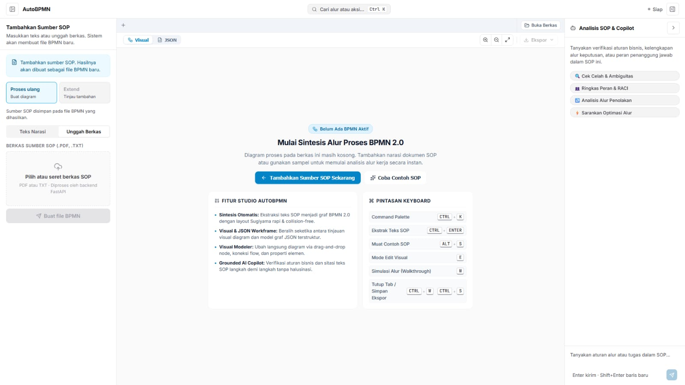
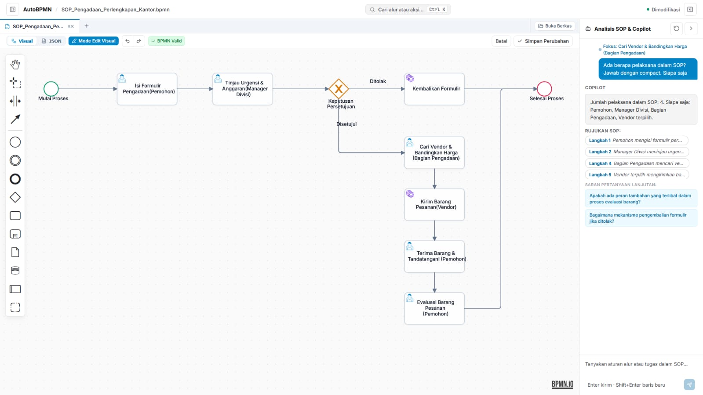
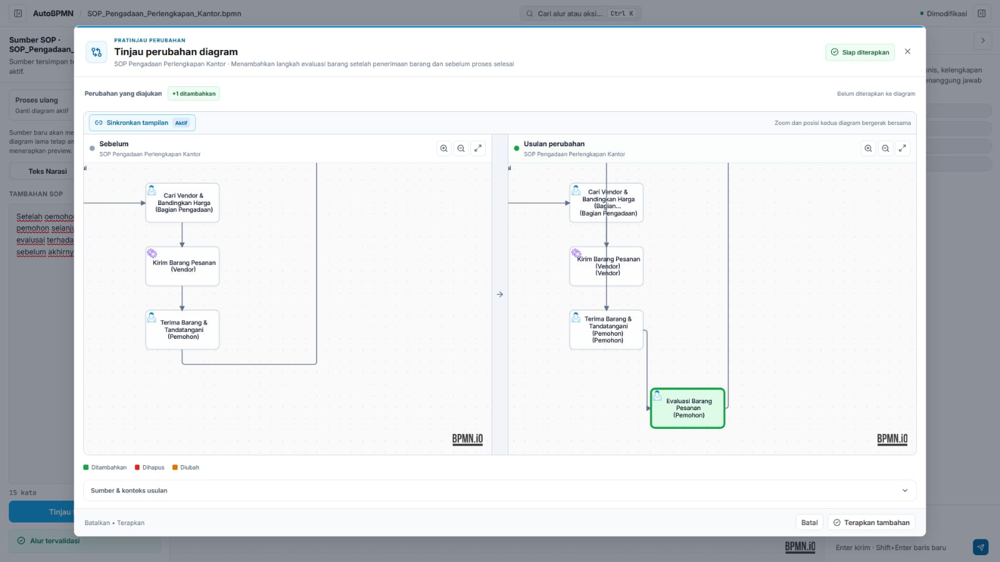

# AutoBPMN

**AutoBPMN** adalah *review studio* berbasis web untuk mengubah dokumen Standard Operating Procedure (SOP) menjadi draft diagram BPMN 2.0 secara otomatis. Aplikasi ini dirancang untuk membantu *business analyst* meninjau hasil ekstraksi, memvalidasi alur proses, mengedit diagram secara visual, hingga mengekspor hasil akhirnya tanpa perlu menyusun XML BPMN dari nol.

> **Catatan Proyek:** Saat ini AutoBPMN berjalan sebagai prototipe lokal. Seluruh data sumber dan diagram disimpan di browser lokal (*client-side*) dan belum terintegrasi dengan layanan *cloud* atau fitur kolaborasi *real-time*.

---

## 📌 Daftar Isi

- [Fitur Utama](#-fitur-utama)
- [Alur Kerja](#-alur-kerja)
- [Mode Aplikasi](#-mode-aplikasi)
- [Tech Stack](#-tech-stack)
- [Cara Menjalankan Secara Lokal](#-cara-menjalankan-secara-lokal)
- [Endpoints API Backend](#-endpoints-api-backend)
- [Penyimpanan & Privasi Data](#-penyimpanan--privasi-data)
- [Batasan Saat Ini](#-batasan-saat-ini)
- [Struktur Direktori](#-struktur-direktori)
- [Dokumentasi & Changelog](#-dokumentasi--changelog)

---

## ✨ Fitur Utama

- **Input Fleksibel:** Masukkan teks SOP secara langsung atau unggah berkas dokumen (`.pdf` / `.txt`).
- **Kanvas Kosong atau Otomatis:** Buat diagram baru dari hasil ekstraksi SOP atau mulai dari kanvas kosong.
- **Mode Extend & Split-View Preview:** Bandingkan alur sebelum dan sesudah perubahan secara *side-by-side* sebelum menerapkan pembaruan ke diagram utama.
- **Multi-Tab Workspace:** Buka beberapa diagram sekaligus dalam tab terpisah. Setiap tab menyimpan *graph*, dokumen sumber, serta riwayat percakapan Copilot-nya masing-masing.
- **Impor & Ekspor Lengkap:** Dukungan impor file BPMN XML dan JSON internal AutoBPMN, serta ekspor ke format BPMN 2.0 XML, JSON model, dan SVG.
- **BPMN Canvas & Editor Properti:** Edit elemen diagram langsung pada kanvas lengkap dengan kustomisasi atribut properti tiap node.
- **AI Copilot Interaktif:** Tanya jawab seputar isi SOP dan konteks diagram dengan dukungan *streaming response* dan sitasi sumber dokumen.
- **Validasi Graph Otomatis:** Verifikasi integritas struktur alur dan konektivitas node sebelum disintesis menjadi diagram BPMN.

---

## 🖼️ Tampilan Aplikasi

### Kanvas kosong dan mulai dari sumber SOP



### Edit visual BPMN dan AI Copilot



### Review perubahan Extend



---

## 🔄 Alur Kerja

```text
Input Teks / PDF / TXT
       │
       ▼
Ekstraksi AI (LLM)
       │
       ▼
Graph Proses AutoBPMN
       │
       ▼
Validasi Struktur Graph
       │
       ▼
Sintesis BPMN 2.0 XML
       │
       ▼
Review, Edit & Ekspor
```

* **Mode Reprocess:** Memproses ulang SOP dan mengganti diagram aktif secara keseluruhan.
* **Mode Extend:** Menghasilkan usulan perubahan dalam bentuk preview *split-view* untuk ditinjau sebelum di-*merge*.

---

## 🚀 Mode Aplikasi

Aplikasi memiliki dua mode operasi yang bisa diganti langsung melalui UI:

1. **Mode Prototipe (`/`)**  
   Menggunakan *mock pipeline* lokal di sisi frontend. Sangat berguna untuk menguji fitur UI, interaksi kanvas, dan alur kerja tanpa memerlukan koneksi backend atau API key.
2. **Mode Demo (`/demo`)**  
   Terhubung langsung ke backend FastAPI nyata. Mode ini memerlukan API key AI provider yang valid untuk menjalankan fitur ekstraksi SOP dan AI Copilot.

---

## 🛠️ Tech Stack

* **Frontend:** React, JavaScript, Vite, HeroUI, Tailwind CSS v4, Lucide React, `bpmn-js`.
* **Backend:** Python, FastAPI, Pydantic, Uvicorn.
* **AI Providers:** Google Gemini, Groq, OpenRouter.
* **Storage:** `LocalStorage` (metadata tab) & `IndexedDB` (sumber SOP & riwayat chat).

---

## 💻 Cara Menjalankan Secara Lokal

### Prasyarat

* **Node.js** (dengan `npm`) & **Python 3.10+**
* API Key dari minimal salah satu provider (Gemini, Groq, atau OpenRouter) jika ingin menggunakan Mode Demo (`/demo`).

### Langkah Instalasi (Windows PowerShell)

1. **Konfigurasi Environment:**  
   Duplikat berkas `.env.example` menjadi `.env`, lalu isi API Key provider AI yang kamu gunakan.
   ```powershell
   cp .env.example .env
   ```

2. **Setup Backend:**  
   Buat *virtual environment* dan pasang dependensi Python:
   ```powershell
   python -m venv venv
   .\venv\Scripts\python.exe -m pip install fastapi uvicorn pydantic google-genai pypdf python-multipart
   ```

3. **Setup Frontend:**  
   Pasang dependensi Node.js:
   ```powershell
   cd frontend
   npm install
   cd ..
   ```

4. **Jalankan Aplikasi:**  
   Kamu bisa menjalankan skrip pembantu `START_AUTOBPMN.bat`, atau menjalankannya secara manual di dua terminal terpisah:

   * **Terminal 1 (Backend):**
     ```powershell
     .\venv\Scripts\python.exe -m uvicorn app.main:app --app-dir backend --host 127.0.0.1 --port 8000 --reload
     ```
   * **Terminal 2 (Frontend):**
     ```powershell
     cd frontend
     npm run dev
     ```

5. **Akses Aplikasi:**  
   Buka `http://localhost:5173` di browser. Buka rute `/demo` untuk menguji integrasi backend. Dokumentasi Swagger API dapat diakses di `http://127.0.0.1:8000/docs`.

> 💡 *Panduan instalasi yang lebih rinci dapat dilihat di [SETUP_GUIDE.md](./SETUP_GUIDE.md).*

### Deploy Gratis ke Internet (Render + Vercel)

Konfigurasi deploy ada di `render.yaml` dan `frontend/vercel.json`. Repository harus tersedia di GitHub agar bisa dihubungkan ke kedua layanan.

1. **Deploy backend di Render:** buka [Render Dashboard](https://dashboard.render.com/), pilih **New > Blueprint**, lalu hubungkan repository ini. Render membaca `render.yaml` dan menjalankan service `autobpmn-api`. Setelah selesai, salin URL service, misalnya `https://autobpmn-api.onrender.com`.
2. **Tambahkan API key AI di Render:** buka **Environment** pada service backend dan tambahkan minimal satu secret: `GEMINI_API_KEY`, `GROQ_API_KEY`, atau `OPENROUTER_API_KEY`. Jangan menaruh key ini di Vercel atau repository.
3. **Deploy frontend di Vercel:** impor repository yang sama di [Vercel](https://vercel.com/new), lalu atur **Root Directory** ke `frontend`. Vercel akan menggunakan `frontend/vercel.json` dan perintah build `npm run build`.
4. Di **Settings > Environment Variables** proyek Vercel, tambahkan `VITE_API_BASE_URL` dengan nilai `https://<URL-BACKEND-RENDER>/api/v1` (ganti dengan URL backend milikmu tanpa garis miring di akhir), lalu redeploy frontend.
5. Salin domain frontend, misalnya `https://autobpmn.vercel.app`. Di **Environment** service Render, set `FRONTEND_ORIGINS` ke domain itu saja, tanpa garis miring di akhir. Jika ada beberapa domain frontend, pisahkan dengan koma. Redeploy backend setelah menyimpan perubahan.
6. Uji backend dengan membuka `https://<URL-BACKEND-RENDER>/health`, lalu buka `https://<DOMAIN-FRONTEND>/demo` untuk mencoba integrasi AI.

Mode prototype di `/` tetap bisa dipakai tanpa backend. Pada paket gratis, service backend Render dapat tidur saat tidak digunakan sehingga permintaan pertama setelah idle mungkin membutuhkan waktu lebih lama. Dokumen dan diagram tetap disimpan di browser pengguna; jangan unggah SOP rahasia karena mode demo mengirim teks ke penyedia AI yang dipilih.

### Build & Testing

```powershell
# Build frontend
cd frontend
npm run build
cd ..

# Jalankan tes backend (pastikan pytest sudah terpasang)
$env:PYTHONPATH = (Resolve-Path backend).Path
pytest backend/tests
```

---

## 📡 Endpoints API Backend

Seluruh API utama berada di bawah prefix `/api/v1/pipeline`:

| Endpoint | Method | Deskripsi |
| :--- | :---: | :--- |
| `/process-text` | `POST` | Ekstraksi struktur SOP dari input teks mentah. |
| `/process-file` | `POST` | Ekstraksi SOP dari dokumen PDF atau TXT. |
| `/validate-graph` | `POST` | Memeriksa validitas dan logika alur graph proses. |
| `/synthesize-graph` | `POST` | Mengonversi graph proses menjadi format BPMN 2.0 XML. |
| `/chat` | `POST` | Endpoint Copilot untuk tanya jawab seputar konteks diagram/SOP. |
| `/chat/stream` | `POST` | Response streaming untuk Copilot. |
| `/ai-edit` | `POST` | Menghasilkan draf *patch* perubahan diagram berdasarkan instruksi. |
| `/apply-patch` | `POST` | Menerapkan *patch* yang telah disetujui ke diagram aktif. |
| `/health` | `GET` | Health check ketersediaan service backend. |

---

## 🔒 Penyimpanan & Privasi Data

* **Client-Side Storage:** Seluruh riwayat tab, isi dokumen SOP, dan log obrolan Copilot tersimpan di `LocalStorage` dan `IndexedDB` browser pengguna.
* **Privasi AI:** Pada mode `/demo`, teks SOP dikirim ke API provider AI yang dikonfigurasi (`Gemini`, `Groq`, atau `OpenRouter`). Pastikan dokumen yang diproses tidak melanggar kebijakan kerahasiaan organisasi Anda.
* **Keamanan API Key:** Jangan pernah meng-commit file `.env` atau mengekspos API Key ke repository publik.

---

## ⚠️ Batasan Saat Ini

- **PDF Text Layer Only:** Berkas PDF yang diunggah harus memiliki lapisan teks (*searchable text*). PDF berupa hasil pemindaian/gambar belum didukung karena belum ada modul OCR bawaan.
- **Batas Panjang Teks:** Teks SOP dibatasi sekitar 16.000 karakter per proses ekstraksi. Untuk dokumen yang sangat panjang, disarankan untuk membaginya menjadi beberapa modul/sub-proses.
- **Verifikasi Manual:** Hasil ekstraksi AI merupakan draf awal. Peninjauan ulang oleh *Process Owner* atau *Business Analyst* tetap diperlukan sebelum diagram digunakan sebagai dokumentasi resmi.

---

## 📁 Struktur Direktori

```text
backend/
  app/
    api/v1/       # Route handlers & endpoints FastAPI
    schemas/      # Validasi data Pydantic & struktur graph
    services/     # Modul ekstraksi, validasi, sintesis & Copilot
  tests/          # Unit test & integration test backend
frontend/
  src/
    components/   # Komponen UI Review Studio & kanvas BPMN
    services/     # Client API, mock pipeline, & pengelola storage
whatsnew/         # Dokumentasi riwayat rilis & changelog
```

---

## 📚 Dokumentasi & Riwayat Rilis

- [Panduan Setup Lengkap](./SETUP_GUIDE.md)
- [Visi Produk & Positioning](./PRODUCT.md)
- [Panduan Kontribusi & Developer Guidelines](./AGENTS.md)
- [Indeks Changelog Utama](./whatsnew/CHANGELOG.md)
- **Catatan Rilis:** [v1.0.0](./whatsnew/v1.0.0.md) · [v1.1.0](./whatsnew/v1.1.0.md) · [v1.2.0](./whatsnew/v1.2.0.md) · [v1.3.0](./whatsnew/v1.3.0.md) · [v1.4.0](./whatsnew/v1.4.0.md) · [v1.5.0](./whatsnew/v1.5.0.md)